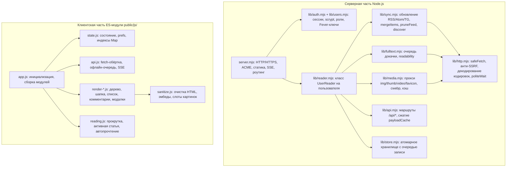

# Аудит кода и план рефакторинга MAK RSS Reader

Документ составлен по результатам полного аудита серверной части (`server.mjs`, `reader-core.mjs`, `lib/*`), клиентской части (`public/*`), Service Worker (`public/sw.js`), стилей (`public/style.css`) и скриптов развёртывания (`deploy/*`, `tools/*`).

---

## P0. Критические ошибки (падения, потеря данных, сломанные функции)

- [ ] **P0.1. Исправить `ReferenceError: feed is not defined` в `GET /api/item`**
  - **Где:** `reader-core.mjs:3039, 3045`
  - **Проблема:** Обращается к несуществующей переменной `feed` вместо `found.feed`. Любой запрос к `GET /api/item?id=...` завершается HTTP 500.
  - **Решение:** Заменить `feed?.kind` на `found.feed?.kind`.

- [ ] **P0.2. Исправить `ReferenceError: __dirname is not defined` в `loadVersion()`**
  - **Где:** `reader-core.mjs:122-128`
  - **Проблема:** В ES-модуле (`.mjs`) переменная `__dirname` не существует; исключение глотается блоком `catch`, из-за чего `GET /api/version` всегда возвращает `'1.0.0'`.
  - **Решение:** Заменить `path.join(__dirname, 'public', 'index.html')` на `path.join(PUBLIC_DIR, 'index.html')` и кэшировать версию по `mtimeMs` файла `index.html`, а не читать файл с диска на каждый запрос.

- [ ] **P0.3. Восстановить потерю метаданных статей при перезапуске сервера**
  - **Где:** `lib/store.mjs:19-29, 138` (`META_FIELDS` и `stripMeta`)
  - **Проблема:** При старте `Store.normalize()` пропускает все статьи через `stripMeta()`, который вырезает все поля вне `META_FIELDS`. В `META_FIELDS` отсутствуют активно используемые поля: `addedAt`, `video`, `commentsSeenMaxId`, `commentsSeenCount`, `commentsSeenAt`, `coverTriedAt`. После каждого перезапуска сервера сбрасываются отметки прочитанных комментариев, пропадают ссылки на видео Telegram и время добавления статей.
  - **Решение:** Добавить все актуальные мета-поля в `META_FIELDS` (или ввести единую схему метаданных статьи, используемую и в `Store`, и в `reader-core.mjs`).

- [ ] **P0.4. Устранить потерю несохранённых тел статей при остановке процесса (конфликт `SIGINT`/`SIGTERM`)**
  - **Где:** `lib/store.mjs:35-49` и `server.mjs:656-667`
  - **Проблема:** `lib/store.mjs` вешает собственные обработчики `process.once('SIGTERM'/'SIGINT')`, которые вызывают `flushAllStores()` (сохраняющий только `state.json`, но НЕ `dirtyFeeds` из `content/`) и немедленно завершают процесс через `process.exit(0)`, прерывая `mod.shutdown()` (`store.flush()`) в `server.mjs`.
  - **Решение:** Удалить обработчики `SIGINT`/`SIGTERM` и `process.exit(0)` из `lib/store.mjs`. Централизованно выполнять graceful shutdown в `server.mjs`: закрыть HTTP/HTTPS серверы, остановить таймеры и бот-циклы, дождаться `await Promise.allSettled(...)` для `store.flush()` всех ядер, после чего завершить процесс.

- [ ] **P0.5. Исправить порчу HTML при обрезке длинных статей в `Store.setBody()`**
  - **Где:** `lib/store.mjs:248-253`
  - **Проблема:** Вычисляется `safe = Math.max(cut.lastIndexOf('
'), cut.lastIndexOf('</figure>'), cut.lastIndexOf('
'))`, а затем всегда берётся `cut.slice(0, safe + 6)`. Для `
` (длина 4) захватываются 2 лишних символа следующего тега, для `</figure>` (длина 9) тег режется посередине (`</figu`).
  - **Решение:** Определять длину конкретного найденного закрывающего тега: искать пары `[tag, cut.lastIndexOf(tag)]` и резать по `index + tag.length`.

- [ ] **P0.6. Починить гонку атомарной записи файлов и двойной инкремент `revision`**
  - **Где:** `lib/store.mjs:153-191`, `lib/users.mjs:41-59`
  - **Проблема:**
    1. В `Store.#writeAtomic()` и `Users.save()` используется фиксированное имя временного файла `${file}.tmp`. При параллельных записях одного файла второй вызов перезаписывает или переименовывает `.tmp` первого, вызывая `ENOENT` и потерю записи.
    2. В `Store.saveStateSoon()` `revision` увеличивается на 1 сразу (`line 154`) и ещё раз внутри `saveStateNow()` (`line 160`) по таймеру — ревизия прыгает через 2; к тому же `saveStateSoon(400, { bump: false })` теряет семантику, если таймер уже поставлен.
  - **Решение:** Ввести сериализованную очередь записи (`Promise`-цепочку на файл) и уникальные имена временных файлов (`${file}.${process.pid}.${++seq}.tmp`). Инкрементировать `revision` строго в одном месте (при мутации в `saveStateSoon` или при `saveStateNow` без двойного вызова).

- [ ] **P0.7. Исправить сломанную установку в `deploy/install.sh`**
  - **Где:** `deploy/install.sh:55-60`
  - **Проблема:** Не копируется `reader-core.mjs` (без него `server.mjs` падает при старте), а `install -m 0644 "$SRC_DIR"/public/* "$APP_DIR/public/"` завершается с ошибкой на подкаталоге `public/fonts/`.
  - **Решение:** Копировать `reader-core.mjs`, а `lib/` и `public/` копировать рекурсивно (`cp -a`), выставляя права на файлы и каталоги.

- [ ] **P0.8. Починить загрузку комментариев для `ixbt.games`**
  - **Где:** `lib/comments.mjs:267`
  - **Проблема:** Проверка `/ixbt\.games$/i.test(link)` матчит конец полного URL (включая путь статьи `/news/...`), поэтому всегда возвращает `false` и шлёт запросы комментариев `ixbt.games` на `www.ixbt.com`.
  - **Решение:** Проверять домен через `new URL(link).hostname`: `/(^|\.)ixbt\.games$/i.test(new URL(link).hostname)`.

- [ ] **P0.9. Починить битый HTML в форме настроек (`#set-density`)**
  - **Где:** `public/index.html:271-276`
  - **Проблема:** Пропущен открывающий тег `<label class="row-line">Плотность списка` перед `<select id="set-density">`, при этом закрывающий `</label>` присутствует. Настройка отображается без подписи, нарушена структура DOM.
  - **Решение:** Восстановить открывающий тег `<label class="row-line">Плотность списка`.

- [ ] **P0.10. Починить окно добавления подписок (конфликт `searchSubscriptions` и `checkAddress`)**
  - **Где:** `public/app.js:3545-3674`
  - **Проблема:** Живой поиск (`searchSubscriptions`) рендерит `.cand`-элементы, а нажатие кнопки «Добавить» (`#add-check`) или `Enter` вызывает `checkAddress()`, который рендерит `<label><input type="checkbox">`, но кнопки подписки для чекбоксов нет, а `subscribeSelected()` ищет только `.cand.active`. В результате нажатие «Добавить» или `Enter` делает подписку невозможной.
  - **Решение:** Удалить устаревшую `checkAddress()`, унифицировать UX на базе одного механизма: по вводу — живой поиск (`searchSubscriptions`), по кнопке «Добавить» / `Enter` — если есть выбранный кандидат `.cand.active`, подписываться (`subscribeSelected()`), иначе запускать поиск.

- [ ] **P0.11. Починить немедленное применение настроек ленты (сортировка, строки, «только картинки»)**
  - **Где:** `public/app.js:3365-3386, 3676-3686, 4569-4579`
  - **Проблема:** `POST /api/feeds/view` возвращает только `{ ok: true, revision }` без `data`, но обработчики `#sort-select`, `#lines-select`, `#menu-lines` и `#images-only` вызывают `applyPayload(...)`, не обновляя поля объекта `feed` в `state.data.feeds`. Изменения не применяются в UI до перезагрузки страницы.
  - **Решение:** Оптимистично обновлять локальный объект `feed` (`feed.sort`, `feed.lines`, `feed.imagesOnly`) и синхронизировать `state.revision = payload.revision`, по аналогии с `setViewMode()`.

- [ ] **P0.12. Починить запуск SSE и лайтбокса после ручного входа в систему**
  - **Где:** `public/app.js:4126-4158, 4451-4473, 4717-4738`
  - **Проблема:** При открытии страницы без сессии `start()` завершается на `showLogin(); return;` до вызова `restoreView()` и `startEvents()`. В `submitLogin()` они не вызываются — после входа живые события `/api/events` и закрытие лайтбокса не инициализированы до ручного F5.
  - **Решение:** Вынести навешивание слушателей лайтбокса в `start()` (единожды при загрузке DOM), а `restoreView()` и `startEvents()` вызывать в общей функции `afterAuthInit()`, используемой и в `start()`, и в `submitLogin()`.

- [ ] **P0.13. Исправить формулу подсчёта `counts.unread` в `POST /api/state`**
  - **Где:** `reader-core.mjs:2871`
  - **Проблема:** `unread: allItems - Object.keys(db.read ?? {}).length` некорректна при наличии в `db.read` записей от удалённых статей (даёт заниженное или отрицательное число).
  - **Решение:** Считать `unread` как сумму значений `feedUnread` по реально существующим статьям в `db.items`.

- [ ] **P0.14. Исправить баги UI и логики в `public/app.js`**
  - **Где и что:**
    1. `public/app.js:2976` (клавиша `m`): тост читает `item.read` уже ПОСЛЕ мутации в `markRead()`, показывая противоположный статус. Сохранять целевое значение `const nextRead = !item.read;` до вызова.
    2. `public/app.js:908-921` (`renderFilterRow`): обновление счётчика `#filters-btn` (`Фильтры (N)`) стоит после `if (!query) return;`, поэтому при пустом поиске число фильтров никогда не отображается. Вынести обновление `#filters-btn` выше `if (!query) return;`.
    3. `public/app.js:1534-1538` (`articleHtml`): `onerror` на `.a-thumb` пытается подставить тот же самый URL `imageSrc(item)`, делая лишний провальный запрос. Удалить бессмысленный fallback и просто скрывать/удалять сломанную миниатюру.
    4. `public/app.js:4745-4752`: интервал опроса `feverMode() ? 60_000 : 20_000` фиксируется при старте скрипта до загрузки настроек с сервера. Заменить на адаптивный `setTimeout`-цикл, перечитывающий `feverMode()` на каждой итерации.
    5. `public/app.js:3107-3112`: при раскрытии статьи из режима `commentsOnly` вызывать `expandItem(id)`, чтобы срабатывали `readOnExpand` и докачка текста.
    6. `public/app.js:2580-2604`: добавить защиту от параллельного выполнения `flushPendingReads()` (флаг `flushingReads` + повторный запуск при новых записях), чтобы быстрая прокрутка не отправляла дублирующие `POST /api/read`.

- [ ] **P0.15. Исправить неработающий кэш данных и версионирование в Service Worker (`public/sw.js`)**
  - **Где:** `public/sw.js:15-26, 52, 61-100, 104, 117-138`
  - **Проблема:**
    1. `isData` проверяет `/api/bodies`, но это `POST`-запрос, который отсекается строкой 104 (`if (request.method !== 'GET') return;`) — ветка кэширования тел статей никогда не выполняется.
    2. В `SHELL` кэшируются `/app.js` и `/style.css`, а `index.html` запрашивает `/app.js?v=330` и `/style.css?v=190` — при `cache.match(request)` без `{ ignoreSearch: true }` кэш не находится.
    3. Функции `negativeCache` и `staleWhileRevalidate` объявлены, но не используются (неудачные `/api/favicon` не кэшируются).
  - **Решение:** Подключить `negativeCache` для `/api/favicon`, использовать `{ ignoreSearch: true }` (или единый способ версионирования) для оболочки, убрать мёртвую ветку `isData` для `POST /api/bodies` (либо реализовать оффлайн-кэш тел в IndexedDB на клиенте).

---

## P1. Безопасность (Security)

- [ ] **P1.1. Устранить SSRF в прокси медиа, видео и парсере лент**
  - **Где:** `reader-core.mjs:312-358, 1564-1578, 1975-2015, 2057-2109, 2128-2135, 2280-2327`
  - **Проблема:**
    1. `isPublicUrl()` проверяет только строку `hostname` регулярками (пропускает IPv6 `::ffff:127.0.0.1`, `fc00::/7`, `fe80::/10`, числовые IP `http://2130706433/`, DNS-имена на приватные IP).
    2. `fetch(..., { redirect: 'follow' })` позволяет обойти `isPublicUrl()` через HTTP 302 редирект с внешнего хоста на `127.0.0.1` или метаданные облака `169.254.169.254`.
    3. `httpGet()`, `httpGetBinary()`, `serveThumb()` и `serveMedia()` вообще не проверяют URL на публичность.
  - **Решение:** Создать единую функцию `safeFetch(url, opts)`: резолвить IP через `dns.lookup()`, проверять все IPv4/IPv6 адреса на приватные/loopback/link-local/unspecified диапазоны, обрабатывать редиректы вручную (`redirect: 'manual'`, максимум 5 шагов с повторной проверкой каждого `Location`). Применить во всех исходящих запросах к пользовательским/внешним URL.

- [ ] **P1.2. Закрыть Path Traversal в `serveMedia()`**
  - **Где:** `reader-core.mjs:2330-2332, 2433-2446`
  - **Проблема:** `postMediaFile(feedId, postId, index)` конкатенирует `url.searchParams.get('f')` и `get('k')` напрямую в имя файла без валидации и без проверки границ каталога `MEDIA_DIR`.
  - **Решение:** Валидировать `feedId` и `postId` строгим шаблоном `/^[A-Za-z0-9_-]{1,64}$/` и проверять `path.resolve(target).startsWith(path.resolve(MEDIA_DIR) + path.sep)`.

- [ ] **P1.3. Обязательная проверка текущего пароля при смене пароля**
  - **Где:** `server.mjs:543-545`
  - **Проблема:** `if (current && !users.verify(me, current))` позволяет обойти проверку, передав пустой `current`.
  - **Решение:** Изменить на `if (!current || !users.verify(me, current)) return json(res, 403, { ok: false, error: 'текущий пароль неверен' });`.

- [ ] **P1.4. Устранить XSS-векторы и инъекции в HTML/JS/CSS**
  - **Где:**
    1. `lib/telegram.mjs:277`: `<a href="${entity.url}">` — валидировать протокол (`/^https?:|^tg:/i`) и экранировать кавычки.
    2. `lib/telegram.mjs:184`: экранировать `quoteAuthor` через `escapeHtml`.
    3. `public/app.js:4819-4838`: в `embedLink()` валидировать схему URL (`/^https?:\/\//i`) перед вставкой в `data-embed` и `href`.
    4. `public/app.js:1973-1984`: экранировать `title` через `esc()` в `updateFooterStats()`.
    5. `public/app.js:693, 1538`: убрать инлайн `onerror="..."` из HTML-строк, заменить на делегированные слушатели `error` в фазе перехвата (`capture: true`) на `#tree` и `#list`.
    6. `public/app.js` (15+ мест): экранировать `id` через `CSS.escape(id)` при подстановке в `querySelector(\`[data-item="${CSS.escape(id)}"]\`)`.

- [ ] **P1.5. Усилить аутентификацию и работу с секретами**
  - **Где:** `lib/auth.mjs:72-77`, `lib/users.mjs:72-76, 193`, `server.mjs:513-528`
  - **Проблема:**
    1. `users.byApiKey()` сравнивает ключи через `===` вместо `safeEqual()`.
    2. `cookieHeader()` не выставляет флаг `Secure` при работе по HTTPS (`req.socket.encrypted || req.headers['x-forwarded-proto'] === 'https'`).
    3. `ensureDefaultAdmin()` выводит реальный пароль в логи в открытом виде.
    4. На `/api/login` нет rate-limiting по IP (параллельные запросы обходят `setTimeout(350)`).
  - **Решение:** Использовать `safeEqual` в `byApiKey()`, передавать `secure` в `cookieHeader()`, не логировать пароль (логировать только факт создания дефолтного админа, если пароль равен `'admin'`), добавить простой in-memory rate limiter по IP на `/api/login`.

- [ ] **P1.6. Убрать личные данные из скриптов репозитория**
  - **Где:** `deploy/install-vps.sh:24`, `tools/publish.ps1:105`, `tools/cdp-traffic.mjs:9, 23`
  - **Проблема:** В скриптах захардкожены личный домен и префиксы IP-адресов VPS.
  - **Решение:** Заменить домен по умолчанию на `rss.example.com` (требовать явную передачу `DOMAIN`), а список запрещённых паттернов для проверки утечек в `publish.ps1` вынести во внешний локальный файл из `.gitignore`.

---

## P2. Производительность, утечки памяти и надёжность

- [ ] **P2.1. Заменить динамический `import('./reader-core.mjs?u=...')` на класс `UserReader`**
  - **Где:** `server.mjs:86-125`, `reader-core.mjs`
  - **Проблема:** Загрузка отдельного ES-модуля с query-параметром на каждого пользователя навсегда утекает в кэш модулей V8 при удалении/отключении пользователя и дублирует код и память.
  - **Решение:** Оформить ядро пользователя как класс `UserReader` (`new UserReader(options)`), хранить экземпляры в `Map` в `server.mjs` и корректно освобождать при `stopCore()`.

- [ ] **P2.2. Исправить бесконечный цикл Telegram-бота при остановке ядра**
  - **Где:** `reader-core.mjs:1893-1926, 3573-3578`
  - **Проблема:** `stop()` сбрасывает `refreshTimer` и `pumpTimer`, но не останавливает `while (true)` в `startTelegramBot()`. Удалённый/отключённый пользователь продолжает бесконечно опрашивать Telegram API.
  - **Решение:** Добавить `AbortController` / флаг `stopped` в экземпляр читалки, прокинуть `signal` в `telegramGetUpdates()` и выходить из цикла при `stopped === true`.

- [ ] **P2.3. Удалить временное логирование на диск (`api-log.txt`) и отладочные `console.log`**
  - **Где:** `reader-core.mjs:2437, 2443, 2469, 2472, 2513-2524, 2636-2639, 2904`
  - **Проблема:** `apiLog()` без ротации пишет каждый запрос к `/api/*` в `data/api-log.txt` (причём в общий `DATA_DIR_DEFAULT`, а не в папку пользователя), рискуя заполнить диск на VPS. Прямые `console.log` в `serveMedia()` спамят в `journalctl`.
  - **Решение:** Удалить `apiLog()`, `API_LOG_FILE`, неиспользуемые переменные в `POST /api/bodies` и шумные `console.log` в `serveMedia()`. При необходимости диагностики включать логирование флагом окружения `DEBUG=1`.

- [ ] **P2.4. Устранить неограниченный рост кэша медиа, ошибки `compressToWebp` и мусорные файлы**
  - **Где:** `reader-core.mjs:662-668, 2156-2217, 2314-2320, 2444, 2464, 2493, 2503`
  - **Проблема:**
    1. `pruneMediaCache()` вызывается только в `serveThumb()`, но не в `serveImage()`, `serveMedia()` и `cachePostMedia()`.
    2. `pruneFeed()` не удаляет `.webp`-копии миниатюр и файлы `tg-<feedId>-<itemId>-*.img` / `.json`.
    3. `compressToWebp()` пишет во временный `${baseFile}.src` и сразу в финальный `${baseFile}.webp` без атомарности; если сжатый файл больше оригинала, он остаётся на диске и отдаётся при следующем запросе!
    4. `serveMedia()` всегда отдаёт заголовок `content-type: image/jpeg` из кэша вне зависимости от реального формата.
  - **Решение:** Вызывать `pruneMediaCache()` во всех точках записи медиа; в `compressToWebp()` писать в уникальный временный `.webp.tmp`, удалять его, если он не меньше оригинала, и атомарно переименовывать при успехе; в `pruneFeed()` удалять связанные `.webp` и `tg-*` файлы; определять `Content-Type` по magic bytes (`ICON_TYPE`).

- [ ] **P2.5. Добавить таймауты на все `fetch()` и ограничение размера ответа**
  - **Где:** `reader-core.mjs:2343, 2365, 2457, 2498, 2501`
  - **Проблема:** Вызовы `fetch()` при кэшировании медиа и работе с Telegram Bot API не имеют `signal` с таймаутом и лимита на объём тела — зависший или огромный ответ блокирует обработчик и расходует память.
  - **Решение:** Пропускать все внешние загрузки через единый HTTP-клиент с `AbortSignal.timeout(...)` и проверкой `content-length` / потоковым лимитом байт.

- [ ] **P2.6. Заменить $O(N \cdot M)$ поиск на `Map`-индексы на сервере и клиенте**
  - **Где:** `reader-core.mjs:402-408, 1716, 2763, 3191-3204`, `public/app.js` (многочисленные `.find()`)
  - **Проблема:** `findItem(id)` линейно обходит все ленты и статьи внутри циклов по `ids` (в `POST /api/read` — дважды на каждый `id`). На клиенте `state.data.items.find()` и `state.data.feeds.find()` вызываются внутри циклов рендеринга и прокрутки.
  - **Решение:** Поддерживать индекс `itemIndex = new Map()` (`itemId -> { feed, item }`) в `UserReader` и `itemsById` / `feedsById` в `public/app.js`, перестраивая при обновлении данных.

- [ ] **P2.7. Перевести SSE (`pushRevisions`) с 1-секундного поллинга на события**
  - **Где:** `server.mjs:366-393`
  - **Проблема:** `setInterval(..., 1000)` опрашивает ядра всех подключённых пользователей каждую секунду.
  - **Решение:** Передавать в `UserReader` колбэк `onRevisionChange(userId, rev)` (вызываемый из `Store` при росте ревизии) и пушить SSE-сообщения мгновенно без таймера опроса (оставив только 15-секундный `keep-alive`).

- [ ] **P2.8. Защитить `lib/traffic.mjs` от утечки памяти и убрать BOM**
  - **Где:** `lib/traffic.mjs:1, 45-50`, `.gitignore:1`, `tools/publish.ps1:1`
  - **Проблема:** Любой произвольный URL от сканеров (404) создаёт новый ключ в `stats.routes`, бесконечно раздувая объект в памяти и `traffic.json`. Файлы содержат UTF-8 BOM в нарушение правила проекта.
  - **Решение:** Нормализовать неизвестные маршруты в `OTHER` (или учитывать только известные префиксы `/api/*`, `/fever/`, `/admin`, `static`) и ограничить максимум ключей в `stats.routes`. Пересохранить файлы в UTF-8 без BOM.

- [ ] **P2.9. Оптимизировать старт сервера и горячие пути рендеринга**
  - **Где:** `reader-core.mjs:3496, 3668-3724, 3157`, `public/app.js:1381-1382, 1447-1472, 2022-2035, 2280, 3118`
  - **Проблема:**
    1. `cleanupStoredBodies()` читает все `content/*.json` всех лент при КАЖДОМ старте сервера — нет флага `db.cleanupVersion`.
    2. `periodicRefresh()` не проверяет `if (refreshing) return;`, а `POST /api/refresh` вызывает `refreshCommentCounts()` дважды.
    3. На клиенте `switchView()` вызывает `render()` 3 раза подряд; на `#list` навешано 3 отдельных `scroll`-слушателя + `document` capture-слушатель (вызывая `trackCommentsProgress` дважды); в `updateActiveArticle()` вызывается `contentTopY(list)` внутри цикла (forced reflow).
    4. `server.mjs:594-597` при анонимном запросе статики поднимает ядро администратора вместо прямой отдачи файлов из `public/`.
  - **Решение:** Добавить `db.cleanupVersion` для однократного запуска миграции; добавить guard в `periodicRefresh()` и убрать повторный `refreshCommentCounts()`; отдавать статику напрямую из `server.mjs`; объединить обработчики `scroll` на `#list` и убрать лишние вызовы `render()` и `contentTopY()`.

- [ ] **P2.10. Починить утечку `MutationObserver` и решить судьбу `scroll-diag.*`**
  - **Где:** `public/scroll-diag.js:62-64`, `public/scroll-diag.css`
  - **Проблема:** Файлы нигде не подключены, а в `scroll-diag.js` созданный `MutationObserver` никогда не отключается в `stop()`.
  - **Решение:** Либо удалить неиспользуемые файлы `scroll-diag.js`/`scroll-diag.css`, либо перенести в `tools/` и добавить `observer.disconnect()` в `stop()`.

---

## P3. Архитектурный рефакторинг и декомпозиция

### Целевая архитектура модулей

- [ ] **P3.1. Декомпозировать `reader-core.mjs` (3776 строк) на модули с классом `UserReader`**
  - Выделить `lib/http.mjs` (единый `safeFetch`, `decodeBody`, `politeWait`, `httpGet`, `httpGetBinary`, `readBody`, `readJson` с корректным HTTP 400 на битый JSON).
  - Выделить `lib/media.mjs` (фавиконы, миниатюры, прокси картинок и видео, `firstGifFrame`, `compressToWebp`, `pruneMediaCache`).
  - Выделить `lib/sync.mjs` (обновление лент, `discoverCandidates`, `addFeed`, `mergeItems`, `pruneFeed`, фильтры, OPML).
  - Выделить `lib/fulltext.mjs` (очередь докачки `fullTextQueue`, `fetchFullText`, `pumpQueue`).
  - Выделить `lib/api.mjs` (обработчики `/api/*` + сжатие `payloadCache`).
  - В `lib/reader.mjs` оставить класс `UserReader`, связывающий подсистемы и управляющий жизненным циклом (`init`, `handleRequest`, `updateAuth`, `stop`, `shutdown`).

- [ ] **P3.2. Убрать дублирование авторизации и статики между `server.mjs` и `reader-core.mjs`**
  - **Где:** `reader-core.mjs:89-90, 224-272, 2527-2624, 3400-3439`, `server.mjs:157-206, 397-405`
  - **Проблема:** Авторизация, сессии, `POST /api/login`, `POST /api/logout`, `POST /api/settings/credentials`, `MIME`, `readBody` продублированы в обоих файлах, причём версия в `reader-core.mjs` фактически недостижима и расходится по поведению.
  - **Решение:** Оставить всю аутентификацию, выдачу статики (с кэшированием сжатых ответов) и общие HTTP-утилиты в `server.mjs` + `lib/http.mjs`, передавая в `UserReader.handleRequest(req, res, url, user)` уже авторизованного пользователя.

- [ ] **P3.3. Устранить дублирование функций парсинга и сериализации в `lib/*`**
  - **Где:** `lib/xml.mjs`, `lib/feed.mjs`, `lib/readability.mjs`, `lib/comments.mjs`, `lib/telegram.mjs`, `reader-core.mjs`
  - **Проблема:**
    - `decodeEntities` / `decodeHtmlEntities` реализованы в 3 разных файлах (`xml.mjs`, `feed.mjs`, `comments.mjs`).
    - `htmlToText` и `absolutize` продублированы в `feed.mjs` и `readability.mjs`.
    - `toMeta`, `payloadItem` и тело `buildPayload` дублируют маппинг полей статьи (уже есть расхождение по `commentsCount: null` vs `undefined`).
    - `pickVideoUrl` дублирует `pickVideoUrls` в `lib/telegram.mjs`.
    - `resolveFeed` дублирует `discoverCandidates` в `reader-core.mjs`.
    - В `lib/readability.mjs:155` `stripJunkBlocks` прерывает цикл `break` при встрече крупной обёртки вместо того, чтобы пропустить её и продолжить поиск следующих рекламных блоков (нужно сдвигать позицию поиска, а не выходить из цикла).
  - **Решение:** Вынести общие строковые/HTML-утилиты в `lib/html.mjs`, унифицировать `payloadItem` (использовать его внутри `buildPayload`), удалить дубли.

- [ ] **P3.4. Декомпозировать `public/app.js` (5103 строки) на нативные ES-модули (`public/js/*.js`)**
  - **Обоснование:** `index.html` уже подключает скрипт с `type="module"` — сборщик не требуется, браузеры нативно поддерживают ES-модули, а разделение упростит поддержку и отладку.
  - **Предлагаемая структура:**
    - `public/js/state.js` — состояние, настройки `prefs`, `localStorage`, индексы `itemsById`/`feedsById`.
    - `public/js/api.js` — `api()`, офлайн-очередь `pendingReads`, `pushSettings()`, SSE `/api/events`.
    - `public/js/sanitize.js` — `sanitize()`, `slotifyImages()`, `setupImageSlots()`, `trimPromoTail()`, `setupEmbeds()`.
    - `public/js/comments.js` — рендер, загрузка, догрузка и отслеживание прочитанных комментариев.
    - `public/js/reading.js` — `updateActiveArticle()`, `positionArticleActions()`, `setupReadObservers()`, автопрочтение, переходы `goRelative()`.
    - `public/js/render.js` — рендер дерева, шапки, карточек (`renderSidebar`, `renderToolbar`, `renderList`, `patchCard`).
    - `public/js/modals.js` — настройки, фильтры, добавление подписки, вход, кастомные `askConfirm()`/`askPrompt()`, лайтбокс.
    - `public/js/mobile.js` — выдвижная панель, меню `⋯`, свайпы, PWA.
    - `public/app.js` — точка входа и привязка событий.

- [ ] **P3.5. Заменить нативные `window.confirm()` и `window.prompt()` на кастомные модальные окна**
  - **Где:** `public/app.js:2916, 2925, 3181, 3191, 3320, 3514, 3518, 4020`, `public/admin.js:106, 110, 116, 117`
  - **Проблема:** В установленном PWA на мобильных устройствах системные `confirm()`/`prompt()` работают нестабильно или подавляются (в проекте уже создана `askConfirm()` для одной кнопки, но остальные 12 мест используют нативные диалоги).
  - **Решение:** Добавить универсальный `askPrompt(title, label, initialValue)` рядом с `askConfirm()` и перевести все подтверждения и ввод названий на кастомные модалки.

- [ ] **P3.6. Очистить и реструктурировать `public/style.css` (1421 строка)**
  - **Где:** `public/style.css`
  - **Проблема:** Многократные переопределения одних и тех же классов в конце файла, конфликтующие медиа-запросы (`@media (max-width: 900px)` на строке 1189 сбивает `padding-right: 50px` у `.a-head` на `8px`, из-за чего плавающие кнопки перекрывают текст заголовка; `.img-row` объявлен сначала как `grid`, потом как `flex`; `.a-thumb` переопределён 6 раз; дублируется `[hidden]`).
  - **Решение:** Сгруппировать правила по логическим секциям (токены/темы → шрифты → каркас → дерево → шапка → карточка → статья/медиа → комментарии → модалки → медиа-запросы в одном блоке в конце), удалить дубли и мёртвые классы (`.add-form`, `.dot`, `.embed-open`, `.a-body img.pending`, `body.actions-hidden`, `body.tools-open`, `.a-actions.floating.settled`).

---

## P4. Очистка мёртвого кода, документация и тестирование

- [ ] **P4.1. Удалить мёртвый и одноразовый код**
  - **`reader-core.mjs`:** неиспользуемые `createServer`, `PORT`, `HOST`, `AUTH_USER`, `AUTH_PASS`, мёртвые ветки авторизации.
  - **`lib/comments.mjs`:** недостижимая ветка `wordpress` (`loadWpComments`, `wpSlugOf`, `WP_API`) и опечатка в имени `tolstoayFetch` → `tolstoyFetch`.
  - **`lib/readability.mjs`:** неиспользуемые `JUNK_HEADING` и `seen` в `addMissedMedia`.
  - **`public/app.js`:** отключённый `PAGED_DATA` и связанные `fetchView`/`fetchViewInner`/`viewParam` (либо довести постраничную загрузку до рабочего состояния и включить), неиспользуемые `pendingNewForFeed`, `pendingNewCountLegacy`, `layoutCardThumbs`, `rememberManualUnread`, `keepManualUnread`, `freezeListForReading`, `unfreezeList`, `inReadingList`, отладочную `showMediaCounters()` (выводить только при `?debug=1`), лишние переменные в `setupPwa()`, `applyVisualPrefs()`, `bodyHtml()`.
  - **`tools/patch/*`:** удалить или вынести из проекта 14 одноразовых патч-скриптов (сейчас они попадают в публичный репозиторий при `publish.ps1`).

- [ ] **P4.2. Автоматизировать версионирование ресурсов**
  - **Где:** `public/index.html`, `public/sw.js`, `reader-core.mjs`
  - **Проблема:** Номера версий `?v=330`, `?v=190`, `rss-shell-v294` приходится править вручную и они рассинхронизируются.
  - **Решение:** Вынести единый номер версии (или вычислять хеш статических файлов при старте сервера) и подставлять его автоматически при отдаче `index.html` и `sw.js`.

- [ ] **P4.3. Актуализировать `README.md` под реальное поведение кода**
  - **Где:** `README.md`
  - **Проблема:** Расхождения по значениям по умолчанию (`MAX_UNREAD_PER_FEED` 1500 vs 3000, `KEEP_READ_DAYS` 30 vs 14, `REFRESH_MINUTES` 10 vs 5), описанию прогрева кэша в SW (удалён), работе фильтров («скрытые статьи возвращаются, если фильтр удалить» в начале vs «снятие фильтра не возвращает удалённое» в конце), опечатка «иначе картинки иначе картинки» (строка 592).
  - **Решение:** Привести `README.md` в соответствие с фактической реализацией и удалить противоречивые устаревшие абзацы.

- [ ] **P4.4. Добавить `package.json` (без внешних зависимостей) и базовые автотесты на `node:test`**
  - **Зачем:** Проект не использует сторонние пакеты, но встроенный раннер `node --test` (Node.js 18+) позволяет тестировать критическую логику без `npm install`.
  - **Покрыть тестами в первую очередь:**
    - `lib/xml.mjs` и `lib/feed.mjs` — разбор RSS 2.0, RSS 1.0 (RDF), Atom, CDATA, сущностей, битых дат.
    - `lib/readability.mjs` — очистка рекламных/навигационных блоков, сохранение картинок и видео, `looksLikePageChrome`.
    - `lib/store.mjs` — атомарная запись при параллельных вызовах, сохранение всех `META_FIELDS`, обрезка `fullHtml` без поломки тегов.
    - `lib/auth.mjs` и `lib/users.mjs` — scrypt, `issueSession`/`readSession`, `safeEqual`.
    - `lib/http.mjs` — блокировка SSRF (приватные IPv4/IPv6, редиректы).
    - `lib/comments.mjs` — определение провайдеров (Habr, iXBT, ixbt.games, Tolstoy, LiveJournal).
    - `lib/fever.mjs` — пагинация (`since_id`/`max_id`/`with_ids`), `mark`.
