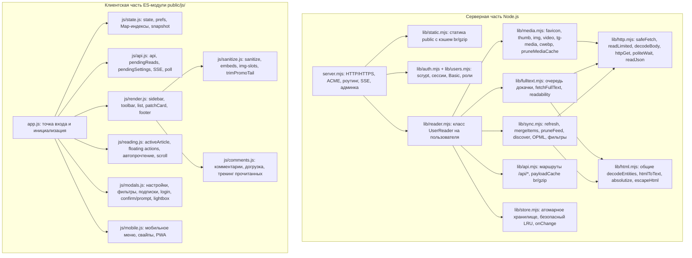

# Аудит кода и план рефакторинга MAK RSS Reader (24.11.2026)

Аудит проведён по фактическому состоянию кодовой базы (`server.mjs`, `reader-core.mjs`, `lib/*`, `public/*`, `deploy/*`, `tools/*`, `test/*`, `README.md`) с учётом изменений, выполненных после `TODO_231126.md` и сверки `TODO-verified-2026-11-23.md`.

Документ содержит только **актуальные нерешённые проблемы**, **вновь выявленные ошибки/регрессии** и **пошаговый план рефакторинга**.

---

## P0. Критические ошибки (потеря данных, падения, сломанные механизмы)

- [ ] **P0.1. Устранить потерю тел статей при LRU-вытеснении в `Store.#loadFeed()`**
  - **Где:** `lib/store.mjs:239-244, 254-264`
  - **Проблема:** `this.openFeeds` ограничен `maxOpenFeeds = 12`. При открытии 13-й ленты (например, во время массового обновления `refreshMany()` по 40+ лентам) самая старая лента вытесняется из `openFeeds` (`this.openFeeds.delete(oldest)`) **без проверки `this.dirtyFeeds.has(oldest)`**. Когда через 5 секунд срабатывает отложенный таймер `#saveFeedSoon`, `#saveFeed()` видит `if (!bodies) return;` и молча теряет все несохранённые тела статей этой ленты.
  - **Решение:** Перед вытеснением записи из `openFeeds` проверять `this.dirtyFeeds.has(oldest)` — либо сбрасывать её на диск (`await this.#saveFeed(oldest, true)`), либо пропускать «грязные» ленты при выборе жертвы LRU и вытеснять только «чистые».

- [ ] **P0.2. Починить устаревание `itemIndexCache` в `reader-core.mjs`**
  - **Где:** `reader-core.mjs:450-465, 625, 727, 1449, 3176, 3219, 3312-3321`
  - **Проблема:** Кэш `itemIndexCache` инвалидируется только при изменении `db.revision`.
    1. В `POST /api/read` `store.saveStateSoon()` (увеличение `revision`) вызывается на строке 3312, затем `findItem(id)` на строке 3317 перестраивает индекс, а затем `pruneFeed(feedId)` на строке 3320 удаляет статьи из `db.items[feedId]` **без** нового `saveStateSoon()`. Удалённые статьи остаются в `itemIndexCache` до следующего изменения ревизии; `GET /api/item` и `POST /api/star` продолжают находить уже удалённые статьи.
    2. Внутри `mergeItems()` / `dedupeFeeds()` / `addFeed()` индекс отстаёт до вызова `saveStateSoon()`.
  - **Решение:** Ввести явный счётчик/функцию `invalidateItemIndex()` и вызывать её при любой мутации `db.items` и `db.feeds` (в `mergeItems`, `pruneFeed`, `purgeFiltered`, `dedupeFeeds`, `addFeed`, `POST /api/feeds/remove`, `POST /api/folders/remove`), а не привязывать валидность индекса к `db.revision`.

- [ ] **P0.3. Исправить гонку и двойную запись в `compressToWebp()`, `serveThumb()` и `serveImage()`**
  - **Где:** `reader-core.mjs:2163-2172, 2239-2272, 2403-2411`
  - **Проблема:**
    1. В `compressToWebp()` временный исходник имеет фиксированное имя `${baseFile}.src` — два параллельных запроса на одну картинку/иконку перезаписывают и удаляют `.src` друг у друга.
    2. `compressToWebp()` атомарно сохраняет `${baseFile}.webp` через `rename(tmp, target)` (строка 2264), но затем `serveThumb()` (строка 2167) и `serveImage()` (строка 2407) повторно и **неатомарно** перезаписывают тот же `${file}.webp` через `writeFile()`.
  - **Решение:** Использовать уникальный суффикс для исходника `${baseFile}.${process.pid}.${++webpSeq}.src` и убрать повторный `writeFile(file + '.webp', ...)` из `serveThumb()` и `serveImage()`.

- [ ] **P0.4. Исправить `ReferenceError: targetUrl is not defined` в `tools/cdp-traffic.mjs`**
  - **Где:** `tools/cdp-traffic.mjs:23`
  - **Проблема:** Литерал `\n` попал внутрь однострочного комментария `//`, закомментировав объявление `const targetUrl = ...`. Скрипт падает при любом запуске на строке 165.
  - **Решение:** Перенести `const targetUrl = ...` на отдельную строку и добавить `tools/*.mjs` и `lib/*.mjs` в скрипт `npm run check` в `package.json`.

- [ ] **P0.5. Исправить гонку в `expandItem()` в режиме Fever (`public/app.js`)**
  - **Где:** `public/app.js:2481-2499`
  - **Проблема:** В режиме `feverMode()` строка 2491 вызывает `ensureBodiesNeeded(true)` **без `await`**, выставляя `state.loadingBodies = true`. Сразу следом строка 2494 вызывает `await ensureBodiesNeeded()`, который мгновенно завершается из-за `if (state.loadingBodies) return;`. В результате на строке 2497 `state.bodies.get(id)` всё ещё пуст, и клиент запускает лишний сетевой запрос `POST /api/fetch-full` со страницы сайта.
  - **Решение:** В `expandItem()` дожидаться загрузки тела через `await ensureBodiesNeeded(feverMode())`, убрав дублирующий несинхронизированный вызов.

- [ ] **P0.6. Исправить баг кэширования версионных ассетов в Service Worker (`public/sw.js`)**
  - **Где:** `public/sw.js:77-88`
  - **Проблема:** `shellFirst()` при промахе точного совпадения (`cache.match(request)`) сразу делает `cache.match(request, { ignoreSearch: true })`. Если в кэше лежит старая версия `/app.js?v=357`, а `index.html` запрашивает `/app.js?v=358` (до смены `CACHE`), воркер отдаст устаревший скрипт из кэша вместо загрузки новой версии из сети, а `import.meta.url` потеряет актуальный номер сборки.
  - **Решение:** В `shellFirst()` для версионных файлов (`?v=`) при промахе точного совпадения сразу идти в сеть `fetch(request)`, а `{ ignoreSearch: true }` использовать только в блоке `catch` как офлайн-фолбэк.

- [ ] **P0.7. Исправить гонку обновления `periodicRefresh()` и «оживание» таймеров после `stop()`**
  - **Где:** `reader-core.mjs:1090, 1094-1101, 1963-1997, 3272, 3699-3706, 3881-3894, 3920-3941`
  - **Проблема:**
    1. `periodicRefresh()` не проверяет `if (refreshing) return;` — автообновление может наложиться на ручной `POST /api/refresh`, а потом сбросить `refreshing = false` раньше времени.
    2. `POST /api/refresh` вызывает `refreshCommentCounts()` дважды (в `refreshMany` на строке 886 и в `finally` на строке 3272).
    3. Если в момент вызова `stop()` выполнялся `periodicRefresh()` или `pumpQueue()`, они по завершении заново поставят таймеры `schedulePeriodicRefresh()` / `scheduleNextPump(4000)`, и остановленное ядро продолжит работать.
    4. `telegramGetUpdates()` не принимает `AbortSignal` — при остановке ядра запрос висит до 30 секунд.
  - **Решение:** Добавить единый флаг `stopped` + `AbortController` для ядра; проверять `if (stopped) return;` в `schedulePeriodicRefresh()`, `scheduleNextPump()`, `pumpQueue()`, `periodicRefresh()`; добавить `if (refreshing || stopped) return;` в `periodicRefresh()`; убрать дублирующий вызов `refreshCommentCounts()` из `POST /api/refresh`; пробросить `signal` в `telegramGetUpdates()`.

- [ ] **P0.8. Починить гонку записи `Users.save()` в `lib/users.mjs`**
  - **Где:** `lib/users.mjs:41-59`, `server.mjs:545, 569, 636`
  - **Проблема:** `Users.save()` использует фиксированное имя `${this.file}.tmp` без очереди записи и на 5-й попытке пишет напрямую в `users.json`. При параллельных запросах (включая `users.touch(user)` без `await`) два вызова `save()` перезаписывают общий `.tmp`, что грозит `ENOENT` или повреждением `users.json`.
  - **Решение:** Добавить сериализованную очередь записи (`Promise`-цепочку) и уникальное имя временного файла `${this.file}.${process.pid}.${++seq}.tmp`; не переписывать `users.json` напрямую при ошибке `rename` (по аналогии со `Store.#writeAtomic`).

- [ ] **P0.9. Починить парсинг паролей с символом `:` в HTTP Basic Auth**
  - **Где:** `server.mjs:223`, `reader-core.mjs:270`
  - **Проблема:** `const [login, password] = Buffer.from(...).toString('utf8').split(':');` обрезает пароль на первом двоеточии.
  - **Решение:** Вынести разбор заголовка `Authorization: Basic ...` в `lib/auth.mjs` (`parseBasicAuth(header)`) с использованием `indexOf(':')`.

---

## P1. Безопасность и корректность (Security & Data Integrity)

- [ ] **P1.1. Исправить обход rate-limit и неограниченный рост `loginAttempts` в `server.mjs`**
  - **Где:** `server.mjs:553-566, 735-765`
  - **Проблема:**
    1. `clientIp(req)` безусловно доверяет заголовку `X-Forwarded-For` от любого клиента — злоумышленник может передавать случайный IP в заголовке на каждый запрос и полностью обойти ограничение 10 попыток/мин.
    2. `Map` `loginAttempts` не очищается от истёкших записей и не имеет лимита размера — при переборе с разных IP память растёт без ограничений.
  - **Решение:** Учитывать `X-Forwarded-For` только когда запрос пришёл с доверенного прокси (`127.0.0.1` / `::1` или заданного `TRUST_PROXY`); добавить периодическую очистку и потолок размера `loginAttempts` (например, 5000 записей).

- [ ] **P1.2. Закрыть оставшиеся пробелы в прокси медиа и SSRF-фильтре**
  - **Где:** `reader-core.mjs:1642, 2053, 2156, 2189, 2211-2218, 2373, 2400, 2616-2623`
  - **Проблема:**
    1. `serveThumb()` (строка 2156), `serveImage()` (строка 2400) и `httpGetBinary()` (строка 1642) читают ответ через `await response.arrayBuffer()` **до** проверки лимита размера, вместо `readLimited()`.
    2. `serveThumb()` в `catch` (строка 2189) делает `302` редирект на `source` даже если `safeFetch` отклонил URL как приватный/небезопасный.
    3. `serveMedia()` (строка 2616) вызывает `fetch(.../getFile)` без таймаута и сохраняет файл бота без `pruneMediaCache()`.
    4. `serveMedia()` (строки 2591 и 2611) по-прежнему отдаёт захардкоженный `content-type: image/jpeg` вместо `sniffImageType(data)`.
    5. Локальная `isPublicUrl()` (строки 2211-2218) дублирует слабую проверку и расходится по коду ответа (`403` vs `404`/`502`) с `safeFetch()` из `lib/net-guard.mjs`.
  - **Решение:** Перевести `serveThumb`, `serveImage`, `httpGetBinary` на `readLimited()`; ввести типизированную ошибку `SsrfError` в `lib/net-guard.mjs` (чтобы маршруты прокси стабильно возвращали HTTP 403 без редиректа); удалить `isPublicUrl()` из `reader-core.mjs`; добавить таймаут и `pruneMediaCache()` в ветку бота `serveMedia()` и заменить оставшиеся `image/jpeg` на `sniffImageType(data)`.

- [ ] **P1.3. Исправить XSS и неэкранированные селекторы в `public/app.js`**
  - **Где:** `public/app.js:1387, 2045, 2169, 2362, 2570`
  - **Проблема:**
    1. В `updateFooterStats()` (строка 2045) текст `problem` подставляется в HTML-атрибут `title="${title}"` без `esc()`.
    2. В 4 местах (`1387`, `2169`, `2362`, `2570`) идентификатор подставляется в `querySelector` без `cssId(...)`.
  - **Решение:** Экранировать `title` внутри `icon()` через `esc()`, обернуть оставшиеся 4 селектора в `cssId(...)`.

- [ ] **P1.4. Исправить флаг `Secure` при выходе и коды ответа на битый JSON**
  - **Где:** `server.mjs:205-211, 574`, `reader-core.mjs:1602`
  - **Проблема:**
    1. `POST /api/logout` в `server.mjs:574` очищает cookie без `secure: requestIsHttps(req)`.
    2. `readJson()` в `reader-core.mjs:1602` при битом JSON бросает `SyntaxError`, возвращая HTTP 500 вместо HTTP 400.
  - **Решение:** Передавать `{ maxAge: 0, secure: requestIsHttps(req) }` в `POST /api/logout`; обрабатывать ошибки парсинга JSON как контролируемый `HttpError(400, 'некорректный JSON')`.

- [ ] **P1.5. Убрать оставшуюся утечку личного домена из `README.md` и BOM из файлов**
  - **Где:** `README.md:453`, `.gitignore:1`, `tools/publish.ps1:1`
  - **Проблема:** В `README.md:453` остался личный домен `(по умолчанию rss.letsplay.today)` (при том что в `install-vps.sh` дефолт уже удалён). `.gitignore` и `tools/publish.ps1` содержат UTF-8 BOM в нарушение собственного правила проекта.
  - **Решение:** Заменить домен в `README.md:453` на описание обязательного параметра `DOMAIN`; пересохранить `.gitignore` и `tools/publish.ps1` в UTF-8 без BOM.

---

## P2. Производительность, память и надёжность

- [ ] **P2.1. Заменить динамический `import('./reader-core.mjs?u=...')` на класс `UserReader`**
  - **Где:** `server.mjs:113-160`, `reader-core.mjs`
  - **Проблема:** Каждый пользователь загружает отдельную копию ES-модуля в кэш V8, которая никогда не выгружается сборщиком мусора (утечка памяти при создании/удалении пользователей и дублирование байткода).
  - **Решение:** Инкапсулировать состояние пользователя (хранилище, таймеры, кэши, очередь докачки, бота) в класс `UserReader` (`new UserReader(options)`), хранить экземпляры в `Map` в `server.mjs`, корректно освобождать в `stopCore()`.

- [ ] **P2.2. Перевести SSE (`pushRevisions`) с 1-секундного поллинга на события**
  - **Где:** `server.mjs:372-426`, `lib/store.mjs`
  - **Проблема:** `setInterval(() => pushRevisions(), 1000)` каждую секунду перебирает всех подписчиков и дёргает `await cores.get(userId)`.
  - **Решение:** Передавать в `UserReader` и `Store` колбэк `onChange({ revision, refreshing })`, вызываемый при инкременте `revision` и смене `refreshing`, и пушить SSE-сообщения по факту изменения (оставив только 15-секундный `: keep-alive`).

- [ ] **P2.3. Убрать лишнюю перезапись неизменённых `content/*.json` при `Store.flush()` и дочистить кэш медиа в `pruneFeed()`**
  - **Где:** `lib/store.mjs:348-356`, `reader-core.mjs:720-725`
  - **Проблема:**
    1. `Store.flush()` принудительно добавляет все открытые ленты (`openFeeds`) в `dirtyFeeds`, перезаписывая на диск файлы тел, которые только читались и не менялись.
    2. `pruneFeed()` удаляет базовый файл миниатюры `thumbFileFor(item.image)`, но не удаляет `${thumbFileFor(item.image)}.webp` и не удаляет файлы Telegram-медиа `tg-${feedId}-${item.id}-*.img`/`.json`.
  - **Решение:** В `Store.flush()` сохранять только ленты из `this.dirtyFeeds`; в `pruneFeed()` удалять также `.webp`-копию миниатюры и связанные `tg-${feedId}-${item.id}-*` файлы (при наличии).

- [ ] **P2.4. Ввести `Map`-индексы на клиенте вместо линейных `.find()` в горячих путях**
  - **Где:** `public/app.js` (`itemsOfView`, `renderSidebar`, `renderToolbar`, `articleHtml`, `bodyHtml`, `updateActiveArticle`, `checkScrolledPast`, `markReadOnce`, `markRead`, `patchCard`, `patchComments`, `toggleStar`, `ensureBodiesNeeded`)
  - **Проблема:** `feedById()` и `state.data.items.find()` вызываются десятки раз на каждый рендер и на каждый кадр прокрутки (суммарно $O(N \cdot M)$).
  - **Решение:** Поддерживать `state.itemsById`, `state.feedsById`, `state.foldersById` (перестраивать в `rebuildIndexes()` внутри `rememberData()` и при добавлении/удалении элементов) и использовать `itemById(id)` / `feedById(id)` за $O(1)$.

- [ ] **P2.5. Оптимизировать горячие пути рендеринга и прокрутки в `public/app.js`**
  - **Где:** `public/app.js:1444-1445, 1510-1542, 2084-2157, 2223-2230, 2320, 3172, 4538`
  - **Проблема:**
    1. `switchView()` вызывает `render()` 3 раза подряд (строки 1510, 1525, 1537).
    2. На `#list` навешано 3 отдельных `scroll`-слушателя + `document` capture `scroll`, причём `trackCommentsProgress()` выполняется дважды на каждое событие прокрутки.
    3. В `updateActiveArticle()` `contentTopY(list)` вызывается в цикле по всем видимым статьям (строка 2097), хотя `lineY` уже вычислено на строке 2084 — лишний forced reflow.
    4. `scheduleActiveArticle()` вызывает `positionArticleActions()` дважды за один кадр (внутри `updateActiveArticle()` и сразу следом на строке 2228).
    5. Слушатель `document.addEventListener('error', ..., true)` навешивается внутри `startEvents()` до проверки повторного запуска.
  - **Решение:** Убрать первый избыточный `render()` в `switchView()` (сразу выставлять `loadingView = true` и рендерить заглушку); объединить обработчики `scroll` на `#list` и убрать дублирующий `document` capture-слушатель (или ограничить его элементами вне `#list`); переиспользовать `lineY` в `visibleArea`; вызывать `positionArticleActions()` один раз за кадр; вынести глобальный слушатель `error` картинок в `start()`.

- [ ] **P2.6. Исправить отдачу статики в `server.mjs` (недостающие MIME и отсутствие сжатия)**
  - **Где:** `server.mjs:67-102, 638-646`, `reader-core.mjs:3514-3554`
  - **Проблема:** В `server.mjs` таблица `MIME` не содержит `.woff2`, `.woff`, `.ttf`, `.jpg`, `.jpeg`, `.webp`, `.gif` — при анонимном запросе шрифта `serveStaticFromPublic()` возвращает `false`, заставляя `server.mjs` поднимать ядро администратора ради отдачи файла. Кроме того, `serveStaticFromPublic()` отдаёт `app.js` (~295 КБ) и `style.css` без gzip/brotli.
  - **Решение:** Перенести единую отдачу статики (полный `MIME` + кэш сжатых `br`/`gzip` буферов по `mtimeMs`) в `lib/static.mjs`, использовать её в `server.mjs` и полностью удалить `staticFile()` из `reader-core.mjs`.

- [ ] **P2.7. Починить прерывание циклов в `lib/readability.mjs` (`stripJunkBlocks` и `stripHeadingSections`)**
  - **Где:** `lib/readability.mjs:125-156, 233-249`
  - **Проблема:** При встрече крупного элемента (`end - start > JUNK_MAX_BYTES`) или заголовка без сетки `
` сразу следом циклы делают `break`, переставая чистить все последующие рекламные/анонсные блоки ниже по документу.
  - **Решение:** Отслеживать позицию поиска (`searchFrom`) с флагом `g` (или сдвигом подстроки), чтобы пропускать неподходящее совпадение и продолжать поиск до конца HTML.

- [ ] **P2.8. Сделать запись `traffic.json` атомарной**
  - **Где:** `lib/traffic.mjs:17`
  - **Проблема:** `writeFile(file, ...)` пишет напрямую, что при аварийном завершении может оставить обрезанный JSON.
  - **Решение:** Писать во временный файл `${file}.${process.pid}.tmp` и переименовывать через `rename()`.

---

## P3. Архитектурный рефакторинг и декомпозиция

### Целевая структура модулей

- [ ] **P3.1. Декомпозировать `reader-core.mjs` (3942 строки) на модули с классом `UserReader`**
  - Разделить монолит на модули с явной передачей контекста `reader` (без глобальных переменных модуля):
    - `lib/http.mjs` — `safeFetch`, `readLimited`, `decodeBody`, `politeWait`, `httpGet`, `httpGetBinary`, `readBody`, `readJson` (с 400 на битый JSON).
    - `lib/media.mjs` — фавиконы, миниатюры, прокси `/api/img`, `/api/video`, `/api/media`, `firstGifFrame`, `compressToWebp`, `pruneMediaCache`, `sniffImageType`.
    - `lib/sync.mjs` — обновление RSS/Atom/Telegram, `discoverCandidates`, `addFeed`, `mergeItems`, `pruneFeed`, фильтры, OPML.
    - `lib/fulltext.mjs` — `fullTextQueue`, `fetchFullText`, `pumpQueue`, `backfillStarredImages`.
    - `lib/api.mjs` — обработчики `/api/*` и `payloadCache` (gzip/brotli).
    - `lib/reader.mjs` — класс `UserReader` (жизненный цикл: `init`, `handleRequest`, `updateAuth`, `stop`, `shutdown`, события `onChange`).
  - После миграции удалить `reader-core.mjs` (или оставить тонкую обёртку обратной совместимости на переходный этап).

- [ ] **P3.2. Убрать дублирование авторизации и HTTP-утилит между `server.mjs` и ядром**
  - **Где:** `reader-core.mjs:88-90, 232-280, 2637-2734, 3514-3554, 3726-3742`
  - **Проблема:** `POST /api/login`, `POST /api/logout`, `GET /api/session`, `POST /api/settings/credentials`, `checkPassword`, `sessionUser`, `isAuthenticated`, `staticFile`, `MIME`, `readBody` дублируются и фактически не используются (перехватываются в `server.mjs`).
  - **Решение:** Всю аутентификацию и отдачу статики оставить в `server.mjs` + `lib/static.mjs`, передавать в `UserReader.handleRequest(req, res, url, user)` уже проверенный контекст пользователя.

- [ ] **P3.3. Устранить дублирование функций парсинга и сериализации в `lib/*`**
  - **Где:** `lib/xml.mjs`, `lib/feed.mjs`, `lib/readability.mjs`, `lib/comments.mjs`, `lib/telegram.mjs`, `reader-core.mjs`
  - **Что унифицировать:**
    1. Создать `lib/html.mjs` с едиными `decodeEntities`, `escapeHtml`, `htmlToText`, `absolutize` — удалить копии из `feed.mjs`, `readability.mjs`, `comments.mjs`, `telegram.mjs`.
    2. В `reader-core.mjs`: использовать `payloadItem(feed, item)` внутри `buildPayload()` (устранив расхождение по `commentsCount: null` vs `undefined`).
    3. В `lib/telegram.mjs`: удалить `pickVideoUrl()`, оставив `pickVideoUrls(chunk)[0] ?? ''`.
    4. В `reader-core.mjs`: объединить `resolveFeed()` и `discoverCandidates()`.
    5. Привести дефолт `defaultView` в `lib/store.mjs:138` (`'compact'`) в соответствие с `reader-core.mjs:215` (`'compact-thumb'`).

- [ ] **P3.4. Декомпозировать `public/app.js` (5253 строки) на нативные ES-модули (`public/js/*.js`)**
  - **Обоснование:** `index.html` уже использует `<script type="module">` — сборщик не требуется.
  - **Шаги:**
    1. Вынести `public/js/state.js` (состояние, `prefs`, `localStorage`, `Map`-индексы, `visibleItems`/`snapshot`).
    2. Вынести `public/js/api.js` (`api()`, `pendingReads`, `pendingSettings`, `applyFeedSetting()` с откатом при ошибке, `loadData()`, SSE).
    3. Вынести `public/js/sanitize.js` (`sanitize()`, `slotifyImages()`, `setupImageSlots()`, `setupEmbeds()`, `trimPromoTail()`).
    4. Вынести `public/js/comments.js` (`commentsHtml()`, `loadComments()`, `markCommentsSeen()`, `trackCommentsProgress()`, `requestCommentCounts()`).
    5. Вынести `public/js/reading.js` (`updateActiveArticle()`, `positionArticleActions()`, `setupReadObservers()`, `checkScrolledPast()`, `goRelative()`).
    6. Вынести `public/js/render.js` (`renderSidebar()`, `renderToolbar()`, `renderList()`, `patchCard()`, `patchComments()`, `updateFooterStats()`).
    7. Вынести `public/js/modals.js` (настройки, фильтры, подписки, вход, `askConfirm()`, `askPrompt()`, лайтбокс).
    8. Вынести `public/js/mobile.js` (выдвижное дерево, меню `⋯`, свайпы, PWA).
    9. В `public/app.js` оставить только сборку и инициализацию.
  - **Важно:** учесть версионирование импортов модулей при обновлении (например, через автоматическую подстановку версии на сервере — см. P4.2).

- [ ] **P3.5. Заменить оставшиеся нативные `prompt()` и `confirm()` в админке (`public/admin.js`)**
  - **Где:** `public/admin.js:106, 110, 116, 117`, `public/admin.html`
  - **Проблема:** В `public/app.js` все нативные диалоги уже переведены на `askConfirm`/`askPrompt`, но в `public/admin.js` остались 4 вызова `prompt()`/`confirm()`, которые нестабильны в мобильном PWA.
  - **Решение:** Добавить модальные окна подтверждения/ввода в `public/admin.html` и функции `askConfirm`/`askPrompt` в `public/admin.js` (с типом поля `password` для смены пароля).

- [ ] **P3.6. Завершить реструктуризацию и дедупликацию `public/style.css` (1457 строк)**
  - **Где:** `public/style.css`
  - **Проблема:** Остались множественные переопределения одних и тех же селекторов и дублирующиеся медиа-запросы:
    - `.a-thumb` переопределяется в строках `577`, `583`, `872`, `876`, `1107`, `1109`, `1298`, `1318`;
    - `.article` переопределяется в строках `543`, `854`, `857`, `868`, `1189`, `1190`, `1196`, `1265`;
    - `.img-row` сначала объявлен как `display: grid` (строки 958-964), а затем переопределён на `display: flex` (строки 1043-1052);
    - `.embed-box` и `.embed-frame` объявлены дважды (строки 1211-1219 и 1288-1291);
    - `.add-candidates label` (строки 411-418) — остаток от удалённой `checkAddress()`;
    - пустой `@media (hover: none) {}` (строка 628);
    - дублирующиеся блоки `@media (max-width: 900px)`, `@media (max-width: 560px)`, `@media (pointer: coarse)` разбросаны по всему файлу;
    - опечатка с иероглифом в комментарии на строке 1313.
  - **Решение:** Слить дублирующиеся правила по секциям из оглавления, удалить мёртвые правила (`.add-candidates label`, пустой `@media (hover: none)`, неиспользуемый `display: grid` у `.img-row`), свести все медиа-запросы в единый упорядоченный блок в конце файла.

---

## P4. Чистка мёртвого кода, документация, деплой и тесты

- [ ] **P4.1. Удалить оставшийся мёртвый и дублирующийся код**
  - `lib/comments.mjs:13, 89-157, 488-497`: недостижимая ветка `wordpress` (для `mobile-review.com` всегда раньше срабатывает `tolstoySiteFor(link)` на строке 480) — удалить либо оформить как явный fallback при ошибке Tolstoy.
  - `lib/readability.mjs:186`: неиспользуемая `seen` в `addMissedMedia()`.
  - `public/sw.js:12, 100-116, 173-185`: неиспользуемые `DATA_CACHE`, `staleWhileRevalidate()` и обработчик `message` (`warm`), кэширующий в нечитаемый кэш.
  - `public/app.js`:
    - неиспользуемые переменные `treeSize` (298), `pendingHint` (855), `kind` (1592), `videoList` (1152), `ids` в `visibilitychange` (2665-2668), `styleTag`/`styleVersion`/`readCount`/`pendingCount` (4761-4766), `pollTimer.unref?.()` (4883);
    - дублирующие проверки `if (readBtn)` (3083-3084) и `if (state_.lastRefresh)` (4407-4408);
    - определить судьбу отключённого флага `PAGED_DATA = false` и 80 строк кода (`fetchView`, `fetchViewInner`, `viewParam`, ветки в `loadData`/`switchView`/scroll): либо доработать и включить, либо удалить.
  - `reader-core.mjs`:
    - неиспользуемые переменные `startedAt`, `values`, `filled` в `POST /api/bodies` (2746-2749) и отладочный `log(...)` в `GET /api/items` (3019);
    - устаревший комментарий «Временный журнал запросов» (2631).

- [ ] **P4.2. Автоматизировать версионирование статики и кэша SW**
  - **Где:** `lib/static.mjs` (новый), `public/index.html`, `public/sw.js`, `tools/bump-version.mjs`
  - **Проблема:** `bump-version.mjs` требует ручного запуска, а после разбиения `public/app.js` на ES-модули (`public/js/*.js`) ручное версионирование импортов станет непрактичным.
  - **Решение:** При старте сервера вычислять короткий хеш (или `mtime`-штамп) файлов `public/` и подставлять его автоматически в `index.html`, `sw.js` (и при необходимости в `importmap` для `public/js/*.js`).

- [ ] **P4.3. Устранить противоречия в `README.md`, `public/index.html` и скриптах деплоя**
  - **Где:** `README.md`, `public/index.html:532`, `deploy/install.sh:101-102`, `deploy/install-vps.sh:107, 145-146`
  - **Что исправить:**
    - `public/index.html:532` и `README.md:65-66`: исправить текст про фильтры («снятие фильтра не возвращает уже удалённые статьи»).
    - `README.md`: исправить устаревшие числа и описания (12 шрифтов вместо 8; 5 минут интервал вместо 10; актуальная стратегия SW без `rss-data-*` и без кэширования `/api/video`; актуальный режим загрузки без несуществующего включённого `PAGED_DATA` и с анонсом 900 символов; убрать личный домен со строки 453).
    - `deploy/install.sh` и `deploy/install-vps.sh`: синхронизировать дефолты в `/etc/rss-reader.env` (`MAX_UNREAD_PER_FEED=3000`, `KEEP_READ_DAYS=14`); в `install-vps.sh` добавить копирование `package.json` и проверку `node --check` как в `install.sh`.

- [ ] **P4.4. Расширить автотесты на `node:test` и усилить `npm run check`**
  - **Где:** `test/*`, `package.json`
  - **Что добавить:**
    1. `test/store.test.mjs` — тест на LRU-вытеснение при >12 «грязных» лентах (регрессия P0.1) и проверку, что `flush()` не переписывает неизменённые ленты.
    2. `test/auth.test.mjs` — `hashPassword`/`verifyPassword`, `issueSession`/`readSession`, `safeEqual`, `parseBasicAuth` с `:` в пароле, `Users` (конкурентный `save()`, `byApiKey`).
    3. `test/comments.test.mjs` — выбор провайдеров (Habr, iXBT, `ixbt.games`, Tolstoy/Mobile-Review, LiveJournal) и разбор их ответов на мок-`httpGet`.
    4. `test/readability.test.mjs` — `extractArticle`, `looksLikePageChrome`, `stripJunkBlocks` (включая крупную обёртку перед рекламным блоком), `stripTrackerImages`.
    5. `test/fever.test.mjs` — аутентификация, `since_id`/`max_id`/`with_ids`, `mark` (item/feed/group, `before`, `unread_recently_read`).
    6. `test/xml.test.mjs` — RSS 1.0 (RDF), CDATA, числовые/именованные сущности, самозакрывающиеся теги, `serializeChildren`.
    7. `test/telegram.test.mjs` — `telegramChannelFromUrl`, `parseTelegramChannel`, `telegramTextToHtml` (защита от `javascript:` в `text_link`), `parseBotUpdate`.
    8. `package.json`: расширить `check`, чтобы синтаксически проверялись `server.mjs`, `reader-core.mjs`, все `lib/*.mjs` и `tools/*.mjs`.

---

## Рекомендуемый порядок выполнения

1. **Этап 1 — Критические исправления (P0 + P1):** P0.1 → P0.2 → P0.3 → P0.4 → P0.5 → P0.6 → P0.7 → P0.8 → P0.9 → P1.1–P1.5. Все правки локальные, минимальный риск, сразу закрывают потери данных, гонки и дыры безопасности.
2. **Этап 2 — Производительность и надёжность без слома архитектуры (P2.3–P2.8 + P4.4 тесты):** починить `Store.flush()`/`pruneFeed()`, клиентские `Map`-индексы, горячие пути `app.js`, `readability.mjs`, `traffic.mjs`, и зафиксировать поведение тестами до крупной декомпозиции.
3. **Этап 3 — Декомпозиция сервера (P2.1 + P2.2 + P2.6 + P3.1 + P3.2 + P3.3):** вынести `lib/html.mjs`, `lib/static.mjs`, `lib/http.mjs`, `lib/media.mjs`, `lib/sync.mjs`, `lib/fulltext.mjs`, `lib/api.mjs`, `lib/reader.mjs` (`UserReader`), перевести SSE на события, убрать дубли авторизации.
4. **Этап 4 — Декомпозиция и полировка клиента (P3.4 + P3.5 + P3.6 + P4.1–P4.3):** разбить `public/app.js` на `public/js/*.js`, автоматизировать версионирование, перевести `admin.js` на кастомные модалки, свести дубли в `style.css`, актуализировать `README.md` и `deploy/*`.
